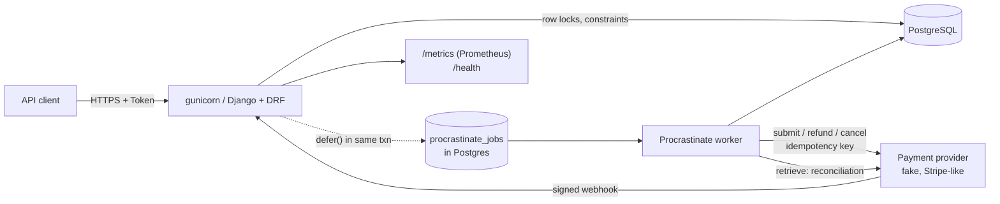
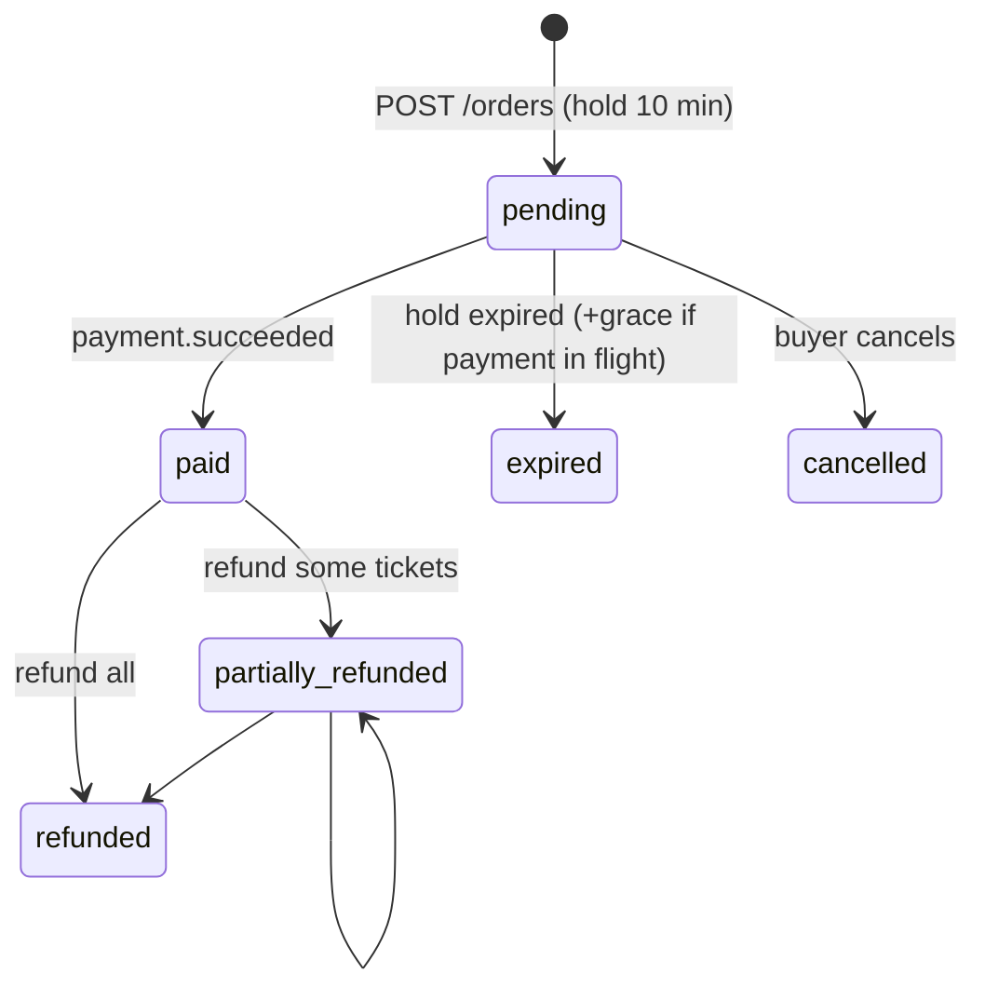

# Ticketing backend

A small event-ticketing API (Django 5 + DRF + PostgreSQL) built to show **correct
transactional code under concurrency**: no overselling, no double charging, safe
retries, idempotent webhooks, and observability. Correctness was prioritized over
feature count. API only; there's no frontend.

- **Real race tests against Postgres.** 50 buyers for the last 5 seats sell exactly 5.
  20 duplicate requests create 1 order. Two simultaneous scans admit 1.
- **Database constraints as the last line of defence.** With the row lock removed, the
  race tests fail, and the CHECK constraint still refuses the oversell.
- **Measured index work.** `EXPLAIN ANALYZE` before/after on ~290k orders is in
  [docs/explain-analyze.md](docs/explain-analyze.md). The load test and an honest
  write-up are in [docs/load-test.md](docs/load-test.md).

## Architecture



| app | responsibility |
|---|---|
| `core` | idempotency keys, audit log, state machine, request-id middleware, JSON logging, metrics, health, Sentry hook |
| `catalog` | Organizer, Event, TicketType (capacity, sale window, per-order limit) |
| `orders` | holds/inventory, order lifecycle, hold expiry, ticket issuance, check-in |
| `payments` | provider interface + fake provider, payments, webhooks, refunds, reconciliation |
| `reporting` | organizer reports, seed / EXPLAIN / load-test commands |

Views are thin. Locking and state transitions live in service functions, which the
tests drive directly and through the API.

### Order lifecycle



One transition table (`ORDER_MACHINE` in `apps/orders/models.py`). An exhaustive test
covers all 36 state pairs. Every transition writes an `AuditLog` row in the same
transaction. Payments and refunds have their own small machines, with terminal states
that never regress.

## Running it

Requires Docker + Compose and `make`. Everything runs in containers on Python 3.12.

```bash
cp .env.example .env
make build && make up        # postgres, web (gunicorn :8000), worker
make migrate
make test                    # ~170 tests incl. concurrency, against real Postgres
make lint
open http://localhost:8000/api/docs/   # Swagger UI (OpenAPI via drf-spectacular)
```

Postgres is published on host port `5433` (`DB_HOST_PORT`), because 5432 is often
taken by a local install. Other targets: `make seed` (demo data),
`make explain` (EXPLAIN ANALYZE report), `make check-inventory`, `make loadtest`
(see [docs/load-test.md](docs/load-test.md)), `make logs`, `make shell`.

### Quick tour with curl

```bash
H='Content-Type: application/json'
ORG=$(curl -s -H "$H" -d '{"username":"org","email":"o@x.io","password":"long-enough-pw"}' localhost:8000/api/auth/register/ | jq -r .token)
BUY=$(curl -s -H "$H" -d '{"username":"bob","email":"b@x.io","password":"long-enough-pw"}' localhost:8000/api/auth/register/ | jq -r .token)
OID=$(curl -s -H "$H" -H "Authorization: Token $ORG" -d '{"name":"Acme Live"}' localhost:8000/api/organizers/ | jq .id)
EID=$(curl -s -H "$H" -H "Authorization: Token $ORG" -d "{\"organizer\":$OID,\"title\":\"Gig\",\"starts_at\":\"2027-01-01T20:00:00Z\",\"currency\":\"USD\",\"is_published\":true}" localhost:8000/api/organizer/events/ | jq .id)
TID=$(curl -s -H "$H" -H "Authorization: Token $ORG" -d '{"name":"GA","price_cents":4500,"capacity":100,"sale_starts_at":"2026-01-01T00:00:00Z","sale_ends_at":"2027-01-01T00:00:00Z"}' localhost:8000/api/organizer/events/$EID/ticket-types/ | jq .id)

ORDER=$(curl -s -H "$H" -H "Authorization: Token $BUY" -H "Idempotency-Key: $(uuidgen)" -d "{\"items\":[{\"ticket_type\":$TID,\"quantity\":2}]}" localhost:8000/api/orders/ | jq .id)
curl -s -H "$H" -H "Authorization: Token $BUY" -H "Idempotency-Key: $(uuidgen)" -d '{"payment_method":"pm_ok"}' localhost:8000/api/orders/$ORDER/pay/
sleep 3; curl -s -H "Authorization: Token $BUY" localhost:8000/api/orders/$ORDER/tickets/
# check-in: CODE from the tickets response; a second scan returns 409 already_checked_in
curl -s -H "$H" -H "Authorization: Token $ORG" -d "{\"event\":$EID,\"code\":\"CODE\"}" localhost:8000/api/checkin/
```

Fake payment methods: `pm_ok` (succeeds), `pm_declined` (fails), `pm_delayed`
(succeeds after `FAKE_PROVIDER_DELAY_SECONDS`), `pm_provider_error` (provider outage;
the submit job retries).

## API summary

| method & path | who | notes |
|---|---|---|
| `POST /api/auth/register/`, `POST /api/auth/token/` | anyone | DRF token auth |
| `GET /api/events/`, `GET /api/events/{id}/` | anyone | published events + live availability |
| `POST/GET /api/organizers/` | user | create / list your organizers |
| `/api/organizer/events/` (+ `/{id}/ticket-types/`) | organizer | CRUD on your own events; others' → 404 |
| `POST /api/orders/` | buyer | **Idempotency-Key** required; holds seats for 10 min |
| `GET /api/orders/`, `/{id}/`, `/{id}/tickets/` | buyer | own orders only |
| `POST /api/orders/{id}/pay/` | buyer | **Idempotency-Key**; 202, outcome via webhook |
| `POST /api/orders/{id}/cancel/` | buyer | releases the hold (409 while a payment is processing) |
| `GET /api/organizer/orders/{id}/` | organizer | order with tickets and payments |
| `POST /api/organizer/orders/{id}/refunds/` | organizer | **Idempotency-Key**; `{"ticket_ids": [...]}` |
| `POST /api/checkin/` | organizer | `{"event", "code"}`; 200 admitted / 409 / 404 |
| `GET /api/organizer/events/{id}/report/` (+ `/timeline/?bucket=hour\|day`) | organizer | sales, revenue, refunds, attendance |
| `POST /api/webhooks/payments/` | provider | HMAC-signed, no user auth |
| `GET /health`, `GET /metrics`, `/api/schema/`, `/api/docs/` | ops | |

Errors are `{"code": "...", "detail": "...", "request_id": "..."}` with stable codes
(`sold_out`, `per_order_limit`, `not_on_sale`, `idempotency_key_reused`,
`payment_in_flight`, `hold_expired`, `over_refund`, `ticket_checked_in`, …).

## Design decisions and trade-offs

### Inventory: row locks rather than optimistic locking

`TicketType.reserved_count` (held + sold) is incremented under `SELECT … FOR UPDATE`.
Postgres enforces `CHECK (0 <= reserved_count <= capacity)` as a backstop.

- **Why pessimistic locking:** an on-sale is the worst case for optimistic locking.
  Every buyer contends for the same row, so a version-check-and-retry scheme makes
  nearly every attempt conflict and retry. That multiplies load exactly when load is
  highest, and fairness becomes random. A row lock queues buyers in Postgres and each
  transaction is short: lock, check, increment, insert the order. That's under 1 ms of
  query time (`docs/explain-analyze.md`, #1).
- **Alternative considered:** a single conditional
  `UPDATE … SET reserved_count = reserved_count + n WHERE reserved_count + n <= capacity`.
  It's lock-free in application code and equally correct for one ticket type. I used
  `FOR UPDATE` because a cart can span several ticket types, and the code reads a value
  (`reserved_count`), decides in Python, then writes several rows. The lock makes that
  read-decide-write explicit and all-or-nothing.
- **Cost:** a single hot row caps throughput for one ticket type at about
  1 / (lock hold time). That's the honest ceiling, and "At 100x scale" below covers
  what to do about it.

**Check-in uses the opposite approach on purpose.** It's a single-row state flip, so
it is one conditional `UPDATE … WHERE status='valid' RETURNING id`, with no explicit
lock. A subtle trap here: writing the permission filter into the ORM update
(`event__organizer__owner=user`) makes Django emit `WHERE id IN (subquery)`. Postgres
doesn't re-run that subquery after waiting on a row lock, so racing scans can both
succeed. **In an experiment that version double-admitted 22 of 30 tickets; ours
admitted 0.** So permission is checked separately, and the UPDATE predicate stays on
the ticket's own columns (raw SQL, `apps/orders/checkin.py`).

### Lock ordering

Every code path takes locks in the order **Order → Payment → Ticket → TicketType**.
Ticket types within a cart are locked in ascending id order. A race test sends half
the carts as `[A, B]` and half as `[B, A]`: no deadlocks.

The order isn't arbitrary. I first planned Payment → Order, then found this deadlock:
a webhook holds payment P1's row while waiting for the Order, and a concurrent `/pay`
holds the Order while inserting payment P2. The partial unique index ("one processing
payment per order") makes P2's insert wait on P1. Each transaction waits on the other.

### How the idempotency key table works

`IdempotencyKey(user, scope, key, request_hash, response_status, response_body)`, with
`UNIQUE (user, scope, key)`. Used on create-order, pay and refund.

1. In one transaction: INSERT the key row under a savepoint.
2. **A concurrent duplicate blocks on the unique index** until the first transaction
   ends. If the first commits, the duplicate gets an IntegrityError → reads the stored
   response → replays it (with `Idempotent-Replayed: true`). If the first rolled back,
   the duplicate's INSERT succeeds and it becomes the owner. No polling and no
   "in progress" state.
3. The same key with a different body (SHA-256 of method + path + canonical JSON)
   → **422**.
4. Business outcomes (201, and 4xx such as 409 `sold_out`) are **stored and replayed**.
   A retried "sold out" must not quietly succeed later as a different outcome.
5. 5xx or a crash rolls back **everything, key included**, so the client can retry.
6. The key, the hold, the expiry job and the audit row commit atomically. Keys expire
   after 24 h (hourly cleanup job); after that a reused key counts as a new request.

The test with 20 concurrent same-key requests produces 1 order and 19 replays.
Separately, the database limits each order to **one in-flight and one successful
payment** (partial unique indexes). Even a client that sends a *fresh* key on every
double-click can't start two charges. The provider call carries its own idempotency
key, so a retried submission job can't charge twice either.

### Transactional outbox via Procrastinate

Jobs are rows in Postgres, and `defer()` uses Django's connection. So **a job
commits or rolls back together with the state change it follows**: hold → expiry job,
webhook → processing job, payment → submit job, paid → email. This avoids the
dual-write problem of "committed the order, then Redis was down". A test shows the job
row vanishing when the hold's transaction rolls back. No external call ever happens
inside a request transaction or under a row lock.

### How holds expire

There are two independent paths, both idempotent:

- **A per-order job** deferred with `schedule_at = expires_at` in the hold's
  transaction.
- **A sweeper every minute** as a safety net. It uses a partial index
  `WHERE status='pending'`, so it stays tiny however much history accumulates, plus
  `SKIP LOCKED`, so it never queues behind a checkout or webhook holding the order.

Both re-check the state under the lock before releasing seats. A race test runs
per-order jobs and sweepers against the same orders: each hold is released exactly
once. A double release would trip the `reserved_count >= 0` CHECK.

**A hold with a charge in flight gets `PAYMENT_GRACE_MINUTES` (15) extra,** so a
slow-but-successful payment doesn't lose its seats.

### What if the payment webhook never arrives?

1. **Reconciliation:** a periodic job asks the provider about payments still
   `processing` 2 minutes after submission. It applies the result through **the same
   handler as webhooks** (same locks, same state machine). If the real webhook shows up
   later, it's a stale no-op. A race test runs both at once and tickets are issued
   once.
2. **Grace period, then expiry:** the order expires, seats are released, and the charge
   is cancelled at the provider.
3. **A success that arrives after expiry is automatically refunded,** with no tickets
   issued. The seats may already be resold, so the system never over-commits
   inventory to honour a late payment.

### Webhook safety

- **Intake:** HMAC-SHA256 over `timestamp.raw_body` with a 5-minute tolerance
  (replay protection) and constant-time comparison. Then `UNIQUE (provider, event_id)`
  dedupe, and the processing job is enqueued in the same transaction. The response is
  200 quickly.
- **Processing:** lock event → order → payment, then ask the state machine. Stale or
  out-of-order events (`processing` or `failed` after `succeeded`, or the same outcome
  resent under a new event id) are stored as `ignored`, with the reason. An amount or
  currency mismatch never marks an order paid.
- **Tests** cover bad, missing, tampered and expired signatures, duplicate delivery, 10
  concurrent deliveries + 5 concurrent processors, out-of-order events, and a webhook
  that overtakes our own submit job.

### Refunds

Refunds are per ticket. The amount is the sum of the tickets' snapshotted prices.
Under Order → Payment → Ticket locks, the code rejects checked-in, already-refunded or
foreign tickets. Refunded tickets can't be scanned, and their seats go back on sale.
`CHECK (refunded_cents <= amount_cents)` makes refunding more than was paid a database
error, not just an application rule. Concurrent refunds of the same ticket refund it
once; concurrent refunds of different tickets sum exactly to the amount paid.

### Money, constraints, indexes

- Money is always integer cents + an ISO currency on the event (one event per order,
  so an order never mixes currencies).
- CHECK constraints cover statuses, non-negative amounts, the sale window, check-in
  consistency and refund limits. Unique constraints cover ticket codes, provider ids,
  idempotency keys and webhook ids. Partial unique indexes enforce one in-flight and
  one successful payment per order.
- Indexes were chosen from `EXPLAIN ANALYZE` on seeded data, not guessed. For example,
  denormalizing `event_id` onto Payment turned a per-event report from a sequential
  scan of *every* payment into an index-only scan (39 → 0.8 ms). Details, including
  two indexes dropped because they only cost writes, are in
  [docs/explain-analyze.md](docs/explain-analyze.md).
- Raw SQL appears only where it earns its place: the reconciliation invariant query,
  the `generate_series` sales timeline, and the check-in UPDATE (explained above).

### Observability

- **Logs:** JSON lines with `request_id` (accepted from `X-Request-ID` or generated,
  and echoed back) and `order_id` once known. Jobs receive the request id that
  enqueued them, so one id traces `POST /pay` → submit job → webhook processing.
- **Metrics:** `/metrics` exposes the `checkout_latency_seconds{outcome}` histogram,
  `checkout_failures_total{reason}` and `webhook_events_total{type,result}`, aggregated
  across gunicorn workers.
- **Error reporting:** Sentry-style, off unless `SENTRY_DSN` is set. Handled anomalies
  such as webhook amount mismatches go through `capture_exception`.
- **Health:** `/health` checks the database.

## At 100x scale

- **Virtual waiting room.** At a big on-sale the bottleneck is one hot row per ticket
  type. Put a queue in front of checkout (admit N buyers per second with signed admission
  tokens) so the database sees a steady stream instead of a thundering herd. It also
  makes ordering fair and lets you show queue position.
- **Shard hot inventory.** Split one ticket type's capacity into K bucket rows (e.g.
  10 × 1,000 seats) and pick a bucket at random, falling back to others when it's
  empty. That gives K-way parallelism on what is currently a single lock.
- **Read replicas** for event pages, availability (which can be slightly stale; the
  authoritative check happens at reserve time) and organizer reports. Cache published
  event pages at the edge.
- **Connection pooling** with PgBouncer (transaction mode) in front of Postgres; sync
  workers × instances would otherwise exhaust connections.
- **Partitioning:** `orders`, `tickets`, `audit_log`, `webhook_events` and the
  procrastinate tables by time (or event), so old data can be dropped or archived per
  partition and hot indexes stay small.
- **Job queue:** Postgres-backed jobs are great for transactional correctness. At very
  high volume, move to a dedicated broker fed by the same outbox table (a relay or
  CDC), keeping the "commit together" property.
- **Separate webhook ingress.** In the load test, provider callbacks queued behind
  buyer traffic on the same workers. Webhooks should have their own pool.
- **Reporting** off the primary: pre-aggregated counters or a warehouse fed by CDC.


## Tests

`make test` runs about 170 tests against real Postgres (no SQLite, no mocked
database). Tests marked `concurrency` use real threads with their own connections,
released together by a barrier:

| race | result asserted |
|---|---|
| 50 buyers, last 5 seats | exactly 5 sell, 45 `SoldOut`, invariant holds |
| random quantities, 50 buyers | never oversells |
| opposite cart order | no deadlocks |
| expiry job vs sweeper | each hold released once |
| 20 same-key checkouts | 1 order, 19 replays |
| same key, different bodies | 1 order, rest 422 or replay |
| 10 pay clicks with fresh keys | 1 payment |
| 10 webhook deliveries + 5 processors | tickets issued once |
| reconciliation vs webhook | tickets issued once |
| 8 refunds of one ticket / refunds of distinct tickets | refunded once / exact sum |
| 2 and 10 simultaneous scans | 1 admitted |
| refund vs check-in | always a consistent end state |

After every race, `inventory_mismatches()` (a raw-SQL invariant check:
`reserved_count == held + sold`) must return nothing. As a sanity check, removing the
`select_for_update()` makes the inventory race tests fail.
